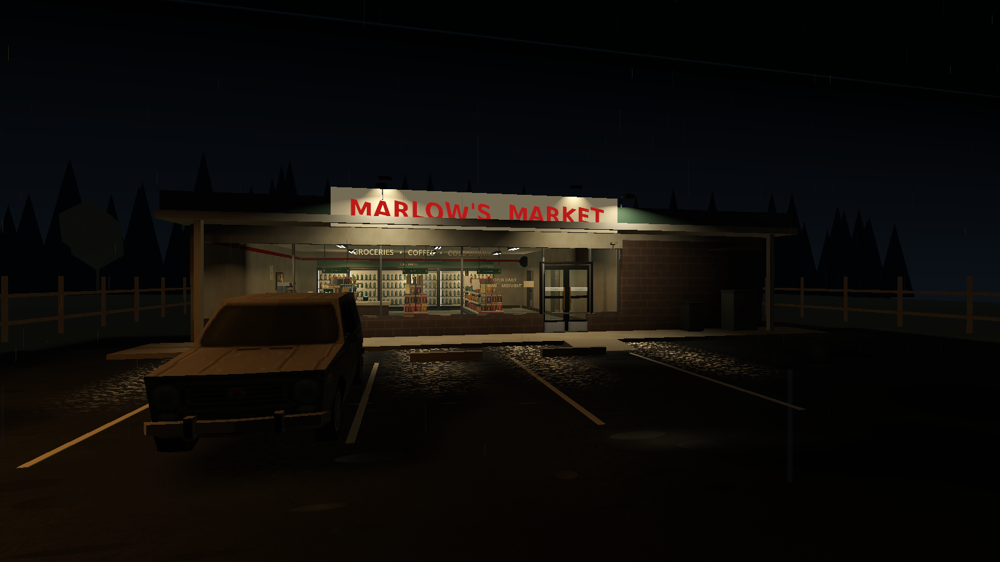

# closing time

it's my first-person horror game about working the last shift at marlow's market.

you play as jamie. ring up the last customers, restock the shelves, take out the trash, answer dina's texts, and keep checking the cameras. at first it's all normal night-shift stuff. then someone you thought had left keeps showing up again.

no ghosts or sci-fi twist. just a fired employee with a spare key and a shift that gets worse the longer you stay. it takes around 10–15 minutes, and there are three endings: get out, hold up in the office until help arrives, or get caught.

## screenshots



this is an actual frame from the game scene, not separate splash art.

## getting started

you'll need **Godot 4.6.3**.

### install

```sh
git clone https://github.com/0xQuerencia/closing-time.git
cd closing-time
```

### run it

```sh
godot --path .
```

or open `project.godot` in Godot and hit **Run**.

## controls

| keys | what they do |
| --- | --- |
| WASD + mouse | move and look |
| Shift | run (Leon hears it) |
| E | use, scan, talk, or hide |
| F | inspect something |
| Q | put an item down |
| 1 / 2 / 3 | pick a reply |
| Tab | check your phone |
| T | phone light |
| C | bring up the shift list |
| G | open the guide |
| Esc | pause |

the pause menu's **Graphics mode** cycles through `SAFE`, `PERFORMANCE`, `BALANCED`, and `QUALITY`. safe turns off shadows and post effects and renders at 65%, while quality keeps the full dark look at native 3D resolution. if a saved setting ever makes the game unhappy, launch the project once with:

```sh
godot --path . -- --safe-mode
```

that forces the safe preset without deleting your saved settings.

if Vulkan itself cannot initialize on your machine, try Godot's compatibility renderer with the same fallback:

```sh
godot --rendering-method gl_compatibility --path . -- --safe-mode
```

## help

if it won't launch, make sure you're on Godot 4.6.3 and try opening `project.godot` from the Project Manager. to run the headless project checks:

```sh
bash scripts/validate_project.sh
```

## credits, AI, and license

Fears to Fathom was a visual reference only. this is an independent game: marlow's, the story, characters, and dialogue are original. licensed third-party assets and fonts are credited below.

AI coding assistants helped with the game code, tests, environment meshes, fictional labels, surface maps, and sounds, working from my design and direction. the game code and validation scripts are in the repo. third-party asset and font credits are in [`ASSET_CREDITS.md`](ASSET_CREDITS.md).

there isn't a top-level license for the project yet. third-party assets keep their original licenses, listed in `ASSET_CREDITS.md`.
